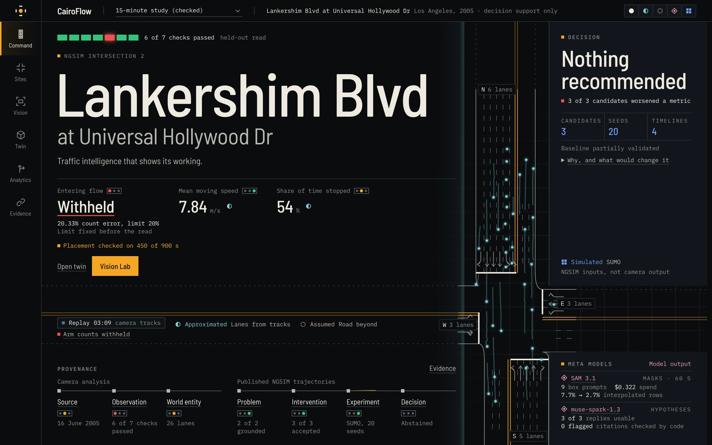
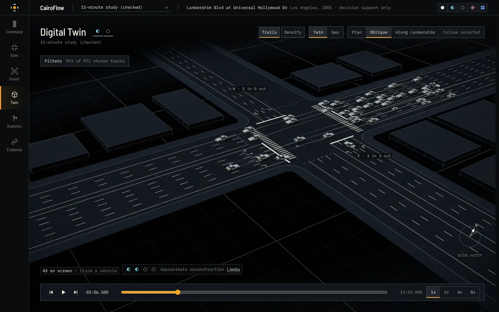
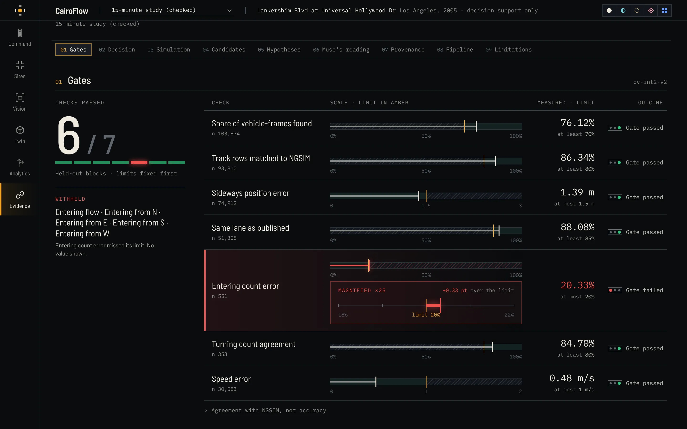
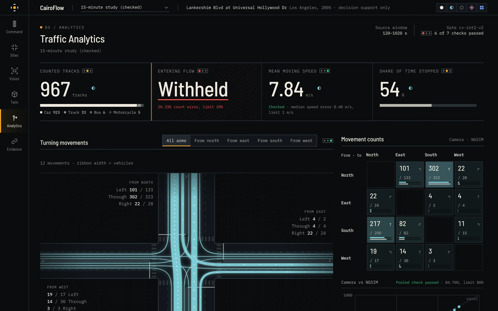

# CairoFlow

**Traffic intelligence that shows its working.**

CairoFlow turns one recorded overhead video, a 2005 NGSIM camera with a placement fitted for this site, into tracked vehicles, turning-movement analytics and a 3D twin of the junction. Each headline figure carries an evidence label and a gate status. When a figure fails its check, CairoFlow withholds it and shows why.

Built for the Meta Global AI Developer Hackathon 2026, using SAM 3.1 and Muse Spark.



## In one minute

- **The problem.** Traffic analytics from cameras usually come as confident numbers with no way to tell which ones hold up. Engineers act on them anyway.
- **What CairoFlow does.** It turns one overhead video into tracks, turning counts, speeds and a 3D twin. Then it scores every headline figure against limits fixed in advance, on footage it was never tuned on. A figure that fails its check isn't shown. The app shows the reason instead.
- **Meta models.** SAM 3.1 refines the tracks on a 60-second window and gives per-vehicle masks. Muse Spark reads the checked evidence and writes hypotheses for an engineer, and it proposes signal changes, which validators and SUMO then test. Code checks every model citation against the evidence.
- **What happened.** 6 of 7 held-out checks passed. Entering counts missed by 0.0033, so the app withholds them. Each of the three interventions tested in simulation made something worse, so the app recommends none. Refusing to publish unchecked numbers is the point of the product.
- **Try it.** Five commands, offline, no API key: see [From a fresh clone](#from-a-fresh-clone). The suite has about 1,800 tests (Python and web).
- **Watch it.** The demo video is cut from captures of the real app. Its Remotion source is in [`video/`](video/), and [docs/VIDEO.md](docs/VIDEO.md) has the storyboard, the voice-over and the commands to re-render it.

| Digital twin: one road network, tracked vehicles on the video's clock | Evidence: each check against the limit fixed before the read |
|---|---|
|  |  |



## What it found

The site is Lankershim Blvd at Universal Hollywood Dr, Los Angeles, filmed for the NGSIM programme on 16 June 2005. The street names come from a present-day map, not the dataset. The 15-minute study counted 967 tracks. That total has no gate behind it and includes tracks that restarted mid-view; the published reference has 1,015 vehicle runs over a larger area. These results come from the local detector and tracker: SAM wasn't part of this run.

We committed limits for seven checks against the published NGSIM trajectories before the first held-out read. The footage is split into alternating 60-second blocks: the detector, tracker and thresholds were tuned on the even ones, and the seven odd ones were scored once. The first read died with its session and produced no result, so a second gate with identical limits took its own single read.

| Check | Held-out result | Limit | |
|---|---|---|---|
| Share of vehicle-frames found (recall) | 0.761 | at least 0.70 | pass |
| Track rows matched to a published NGSIM vehicle (within 3 m across, 8 m along) | 0.863 | at least 0.80 | pass |
| Position error across the road, 90th percentile | 1.39 m | at most 1.5 m | pass |
| Lane agreement | 0.881 | at least 0.85 | pass |
| Turning-movement agreement | 0.847 | at least 0.80 | pass |
| Median speed error | 0.48 m/s | at most 1.0 m/s | pass |
| Entering count error | **0.2033** | at most 0.20 | **fail** |

Entering counts missed by 0.0033. The limit was fixed before the read, so it stays where it is. In the 15-minute study the app withholds entering flow and per-arm entering counts and shows the reason in their place. The ungated 60-second SAM window still shows its own entering figures, marked ungated. We won't take another read: a new gate version could read these blocks, but the held-out data has now been seen, so the result wouldn't be blind.

This is agreement with NGSIM, not accuracy. The reference shares the video, and no independent human labels exist. The camera placement was never held out: it was fitted on points Claude read from video frames, 15 of 29 of them from frames inside the odd blocks, so the position and lane rows aren't independent of that fit. The limits apply to the seven blocks pooled, and single blocks missed them, as [Limits](#limits) sets out.

**The decision.** Muse Spark proposed interventions, and SUMO tested three candidates over 20 paired seeds across a four-timeline ensemble. Every candidate worsened at least one metric, and no baseline is validated (two timelines partly, two not assessed), so CairoFlow recommends nothing. That recorded decision used the published NGSIM inputs, not this camera output, and the app says so.

## From a fresh clone

You need [uv](https://docs.astral.sh/uv/), Python 3.12 and Node 24. No API key is needed.

```bash
uv sync --frozen
uv run --frozen pytest -q
npm --prefix apps/web ci
npm --prefix apps/web run build
bash scripts/demo_run.sh
```

Open <http://127.0.0.1:8000>. The precomputed analyses are in the repository, so the 3D twin, analytics and evidence pages work offline. Only a new paid request needs a key: copy `.env.example` to `.env` and set `MODEL_API_KEY`. The demo, the tests and the replays below don't need it.

**Footage isn't in this repository.** It's CC BY-SA 4.0 and freely available, and we chose to keep pixels out. To see the annotated video, fetch the source (449 MB, checked by SHA-256) and render it locally from the stored record:

```bash
uv run --frozen python scripts/fetch_ngsim_data.py --download camera2
uv run --frozen python scripts/render_annotated_video.py --analysis data/sample/analyses/cv-ngsim-int2-15min-study
```

**The World Model view** behind `/flow` and `/world` isn't committed, so those panels say it's absent until you build it from the published trajectories (about 54 MB). The rebuild has to match the committed record, and the launcher refuses a view that differs from its pin:

```bash
uv run --frozen python scripts/fetch_ngsim_data.py --download trajectories
uv run --frozen python scripts/build_ngsim_int2_scenario.py --as-of 2026-10-28T07:43:04Z --check-record
uv run --frozen python scripts/build_worldview_snapshot.py
```

**Run reports** live in `experiments/runs`, which Git ignores. After that rebuild, this replays the first recorded experiment offline from the Muse reply in `cache/muse`. It ends with `selected: None trace problems: 0` and writes a new run directory, whose report the server shows at `/runs/<directory name>`:

```bash
uv run --frozen python scripts/run_ngsim_int2_experiment.py --prompt-version 0.1.0 --max-output-tokens 7000
```

`bash scripts/fresh_clone_check.sh` runs the tests, the demo and that rebuild on a clean clone, and compares every rebuilt SHA-256 with its pin.

**Live analysis** runs the detector and tracker on a video file you choose, not a live stream, with progress taken from the worker. It runs neither SAM nor the gate, so its figures stay ungated. It needs the vision extra, in its own environment:

```bash
UV_PROJECT_ENVIRONMENT=$HOME/.venvs/cairoflow-vision uv sync --frozen --extra vision
CAIROFLOW_VISION_PYTHON=$HOME/.venvs/cairoflow-vision/bin/python bash scripts/demo_run.sh
```

This uses the default Apache-2.0 detector, which finds fewer vehicles than the one behind the shipped study (0.64 against 0.81 recall on tuning frames). To reproduce the study, add `--extra vision-agpl` and set `CAIROFLOW_DETECTOR=visdrone-yolo26s`. An uploaded video runs uncalibrated: you get image-space tracks and class counts, and the twin says it can't place those vehicles. Windows from the held-out blocks of the NGSIM video are refused, and the app offers valid ones.

The web app has its own tests: `npm --prefix apps/web test`.

## How it works

```
CAMERA LANE
video -> frames -> detector -> tracker -> trajectories -> placement -> analytics -> agreement gate
  -> analysis directory: record.json + tracks.json + trajectories.bin
       |-> SQLite index -> FastAPI -> one playback clock -> video, overlay, 3D, charts
       |-> analysis record -----------> Muse Spark -> hypotheses for a person (stops here)
                                            |
                                  same model, separate requests
                                            |
published NGSIM trajectories ---------> Muse Spark -> proposals -> validators -> SUMO -> decision record
DECISION LANE
```

Muse Spark is the only thing the two lanes share. SAM 3.1 is in neither: it ran offline on one 60-second dev window, seeded from that window's tracks.

Each analysis is one immutable directory. The contract in [`analysis_record.py`](packages/contracts/cairoflow_contracts/analysis_record.py) enforces this much: a `Metric` with status `gate_fail` can't carry a value, and `data_origin` keeps camera output apart from published reference data. Which metrics get that status is decided per analysis, and turning-matrix row sums stay visible.

| Path | What's there |
|---|---|
| `apps/web` | The product: Vite, React, TypeScript, Tailwind, React Three Fiber |
| `apps/api` | FastAPI, job worker protocol, SQLite index |
| `packages/contracts` | Pydantic contracts with versioned JSON Schema snapshots |
| `packages/perception` | Detector adapters, tracker, zones, analytics, SAM adapter |
| `packages/reasoning` | Muse adapter, prompts, grounding checks |
| `packages/simulation` | SUMO network, scenario compiler, runner |
| `packages/evaluation` | Metrics, significance, agreement gate |
| `data/sample` | The analyses and summaries the app ships with |
| `experiments/records` | Immutable records behind the gate, bake-off, SAM and simulation figures; analysis totals are in `data/sample` |

## How the Meta models are used

**SAM 3.1** started as the only perception model. Asked for "car", it followed at most 16 objects and picked up none after the first frame. On its best window, a tuning window, SAM's tracked boxes reached a recall of 0.45, the detector's raw boxes at confidence 0.03 reached 0.84, and our tracked output reached 0.80. Recall across the held-out blocks is 0.76. So on one 60-second window, the detector's tracks went to SAM as box prompts, in groups of up to 16, which lets SAM follow vehicles that appear after the first frame.

That cost $0.32 and did this, with the full record in [`experiments/records`](experiments/records):

- SAM, seeded from these same tracks, agreed with 9,900 of the 10,858 observed detector rows (49 rejected, 909 not reached). That's a consistency check, not independent confirmation.
- Replaced 586 interpolated rows with SAM's own boxes, taking interpolated rows from 7.7% to 2.7%. Those rows matched the reference no more often than before (542 of 586 either way).
- Tightened across-road position on those rows, from a median error of 0.37 m to 0.29 m. Along-road error didn't improve (0.55 m to 0.58 m).
- Gave per-vehicle masks. Mask length changed 5 of 101 vehicle classes: 4 then agreed with the reference's length bands, including a bus the detector called a truck, and 1 didn't.

These are dev-block figures. Scored recall rose from 0.79 to 0.84, but a control that keeps the same rows at their interpolated positions scores 0.835. The gain comes from counting those rows, not from SAM's positions, so we don't claim SAM raised recall.

**Muse Spark** reads a structured list of evidence, figures included, and its reply schema has no numeric field. On the 15-minute study it returned three separate replies to the same request. Code then checks that every cited id exists and flags numerals in the summary, statements and how-to-check text that match no evidence value. It doesn't judge whether a citation supports the claim. All three replies passed both checks. None cited the withheld items, whose values were blank and which the prompt told it not to use, though they still reasoned from the turning movements. Each listed a north-south through hypothesis first, but they differ after that: two rated it medium, one of them giving queuing the same confidence, and the third rated it low and gave a computer-vision artefact medium. These are hypotheses for a person to test, shown as model output. In the decision chain, Muse also proposes interventions, which deterministic validators and SUMO then judge.

Meta API spend since the delivery [ledger](experiments/records/meta-spend-20261104.jsonl) began on 3 November was an estimated $0.51, at published prices. Earlier experiments add to that, and are recorded with their runs in `experiments/records`.

## Limits

- **One site, one camera, 2005.** This is Los Angeles. No Cairo data is used, despite the name.
- **Passing pooled isn't passing everywhere.** Block by block, across-road p90 ran from 0.89 to 2.17 m (over the limit in 3 of 7), turning agreement from 0.68 to 0.95 (under in 3), lane agreement from 0.69 to 0.99 (under in 2) and recall from 0.68 to 0.83 (under in 2).
- **Movement cells have no check of their own.** Turning agreement is pooled over the held-out blocks, not measured cell by cell.
- **The match row has a floor.** On dev frames, raw detector boxes scored 0.47 on it against a reference shifted by 120 s, so it doesn't start from zero.
- **Dev figures were optimistic.** Across-road error was 0.96 m on dev blocks and 1.39 m on held-out ones.
- **The detector misses vehicles.** A visual check found stopped vehicles with no box, including on an approach NGSIM doesn't cover, so recall can't show those misses.
- **Vehicle classes are unchecked.** NGSIM publishes a `v_class` field (motorcycle, auto, truck), but the columns we fetched leave it out, so classes weren't compared and class counts stay ungated.
- **Speed is agreement only.** Along-road distances from this homography aren't accepted as measurements. Speed is shown because, on vehicles moving at 2 m/s or more, it agreed with NGSIM within the limit. That agreement is empirical, not a property of the homography. Stopped share has no gate, because that check doesn't cover stopped time.
- **The seeds measure simulator noise.** The 20 seeds vary SUMO's noise on one replayed 10.5-minute window, not demand.
- **The twin is approximate.** Road geometry is derived from trajectories, vehicle bodies are schematic, and the blocks beside the road are context, not surveyed buildings.
- **Decision support only.** Nothing here controls real traffic.

## Data and licences

Code is [MIT](LICENSE). Third-party terms are in [NOTICE](NOTICE), and where a record's own notice differs, NOTICE says which applies.

Derived tracks and analytics in [`data/sample`](data/sample/LICENSE.md) are CC BY-SA 4.0, adapted from the [NGSIM Lankershim Boulevard data](http://doi.org/10.21949/1504477) from the U.S. Federal Highway Administration. No footage is in this repository.

The shipped study used the optional VisDrone YOLO detector, which is AGPL-3.0, because it found far more vehicles on this overhead view: 0.81 recall against 0.64 for the best Apache-2.0 model on tuning frames. It isn't distributed here and isn't installed by default. The default detector is Apache-2.0, and every analysis records which detector, weights and licence it used. Running the optional detector makes that runtime subject to the AGPL.

## Disclosure

Built during the hackathon, which began on 26 October 2026. The first two commits of the development repository are dated 26 October at 23:22 and 23:37 Cairo time (a scaffold and a baseline SUMO network). This public repository is a fresh export of that private repository, made to exclude footage and working files, so its history doesn't show that development.

Development was assisted by Claude, Anthropic's AI coding assistant. Every output from SAM 3.1 and Muse Spark comes from Meta's Model API and is labelled as model-generated; detector boxes come from a local third-party model. One calibration input is the exception: the points the homography is fitted and checked on, in `cross_clicks.json` and `stop_gap_clicks.json` under `data/geometry/ngsim-lankershim-cam2/v2`, were read from video frames by Claude, and those files say so.

See [the architecture notes](docs/ARCHITECTURE.md), [the decision log](docs/DECISIONS.md), [every claim and its evidence](docs/CLAIMS.md) and [the demo walkthrough](docs/DEMO.md).
